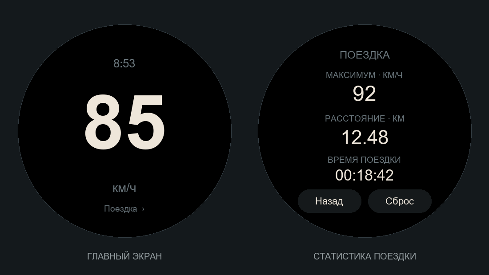

# Speedometer — Amazfit T-Rex 3

Минималистичный GPS-спидометр: чёрный экран, крупные бежевые цифры, только км/ч. Написан с нуля. Без рекламы, платежей и пробного периода.



Картинка — макет, а не снимок с часов. На устройстве используется системный шрифт Zepp OS; его начертание может отличаться.

## Что работает в исходниках

- Текущая скорость, максимальная скорость, расстояние и время поездки.
- Нажатие на скорость или «Поездка» открывает статистику.
- «Назад» возвращает к спидометру.
- «Сброс» → «Точно?» в течение 4 секунд начинает новую поездку.
- Статистика сохраняется каждые 10 секунд и при нормальном закрытии приложения.
- После открытия продолжается сохранённая поездка. Время закрытого приложения не учитывается.
- Нет свежего GPS более 5 секунд — скорость скрывается. Участок без сигнала не добавляется к расстоянию.

**Статус:** 8 автоматических проверок расчётов и интерфейсной логики пройдены. Проверки интерфейса используют заглушки API часов. Локальная сборка остановлена ограничением среды `spawn EPERM` при запуске esbuild. Установочный пакет пока не получен; на настоящем T-Rex 3 приложение ещё не проверялось. Workflow GitHub Actions подготовлен, но ещё не запускался.

## Установка из проекта на GitHub

GitHub хранит исходники и запускает сборку. Установка на часы выполняется через QR-код Zeus и приложение Zepp на телефоне, а не открытием GitHub ZIP на часах. Это официальный [способ предварительной установки Zepp OS](https://docs.zepp.com/docs/guides/quick-start/preview/).

### 1. Поместите проект в свой репозиторий

1. Распакуйте `Speedometer-source.zip`.
2. На GitHub создайте пустой репозиторий `Speedometer`.
3. Загрузите **содержимое папки Speedometer**, а не ZIP: в корне репозитория должны находиться `app.json`, `package.json`, `package-lock.json`, `app.js`, `README.md`, а также папки `page`, `lib`, `assets`, `scripts`, `tests`, `design` и `.github`.
4. Убедитесь, что файл `.github/workflows/build.yml` тоже попал в репозиторий. При необходимости создайте его через **Add file → Create new file**, указав этот полный относительный путь, и вставьте содержимое файла из архива.

Для загрузки через Git вместо браузера: откройте терминал в распакованной папке Speedometer, замените `YOUR_LOGIN` своим логином и выполните:

```sh
git init
git add .
git commit -m "Initial Speedometer for T-Rex 3"
git branch -M main
git remote add origin https://github.com/YOUR_LOGIN/Speedometer.git
git push -u origin main
```

Если Git запросит имя и email автора, настройте их для этого репозитория и повторите commit. При push используйте вход GitHub через браузер.

### 2. Проверьте сборку на GitHub

Откройте **Actions → Build Speedometer**. После загрузки кода сборка запустится автоматически; также доступна кнопка **Run workflow**. Workflow установит зависимости, выполнит тесты и попробует создать `.zab` для T-Rex 3.

Если запуск зелёный, внизу его страницы появится **Artifacts → Speedometer-T-Rex-3**. Нужен вход в GitHub, чтобы скачать артефакт. Если запуск красный — откройте упавший шаг: это ошибка сборки, а не готовое приложение. [Инструкция GitHub по артефактам](https://docs.github.com/en/actions/how-tos/manage-workflow-runs/download-workflow-artifacts?tool=webui).

Артефакт предназначен для хранения результата сборки. Для первой установки используйте QR-процедуру ниже: она сама соберёт и загрузит preview на сервер Zepp.

### 3. Получите QR-код на компьютере

Установите [Node.js](https://nodejs.org/) версии 22 и, если используете клонирование, [Git](https://git-scm.com/downloads).

Скачайте свой репозиторий через **Code → Download ZIP** и распакуйте. Откройте терминал в папке, где лежит `package.json`. Либо клонируйте:

```sh
git clone https://github.com/YOUR_LOGIN/Speedometer.git
cd Speedometer
```

Затем:

```sh
npm ci
npm test
npm run preview
```

В Windows PowerShell, если запрещён запуск `npm.ps1`, используйте `npm.cmd ci`, `npm.cmd test`, `npm.cmd run preview`.

Zeus предложит авторизоваться в аккаунте платформы Zepp. Завершите вход самостоятельно; пароли или токены в репозиторий не добавляйте. Если потребуется регистрация разработчика, выполните её на [Zepp OS Developer](https://developer.zepp.com/). При выборе устройства укажите **Amazfit T-Rex 3**. После успешной сборки и загрузки в терминале появится QR-код. Команда preview обращается к серверам Zepp и требует интернет. [Документация Zeus](https://docs.zepp.com/docs/v2/guides/tools/cli/).

В `app.json` задан технический тестовый `appId`. Если платформа потребует зарегистрированный App ID или при публикации в магазине, создайте собственное приложение в кабинете разработчика и замените `app.appId` выданным числом. Не используйте ID исходного Speedometer Pro.

### 4. Установите на часы

1. Подключите T-Rex 3 к Zepp на телефоне.
2. В Zepp откройте **Профиль → Настройки → О приложении**.
3. Нажмите на значок Zepp 7 раз, чтобы включить режим разработчика.
4. Откройте страницу ваших T-Rex 3 → **Режим разработчика → Сканировать**.
5. Отсканируйте QR-код из терминала и дождитесь передачи приложения.
6. Откройте **Speedometer** в списке приложений часов и разрешите геолокацию, если часы запросят её.

Названия пунктов могут немного различаться между версиями Zepp. [Официальная инструкция режима разработчика](https://docs.zepp.com/docs/guides/tools/zepp-app/).

Если QR-код устарел, снова запустите `npm run preview`. QR-код обычной страницы GitHub или ссылка на ZIP не заменяют код установки Zepp.

## Первое использование и ограничения версии 1.0

Выйдите на открытое место и дождитесь GPS. После первого сигнала нужно около 3 секунд для расчёта скорости. На главном экране отображается местное время часов. Статистика доступна по нажатию на цифры.

Скорость рассчитывается из GPS-координат, поскольку используемый API Geolocation не предоставляет готовую скорость. Используется окно 3 секунды, небольшое сглаживание и отсечение явно невозможных скачков. Поэтому показание реагирует с задержкой, а в зданиях, рядом с высокими домами и на малой скорости возможны погрешности. Скорость ниже 3,6 км/ч считается остановкой: это версия для поездок, не для точного подсчёта пешего пути. Дистанция между отсчётами считается по прямой, поэтому извилистый путь может недооцениваться.

Время поездки — время работы открытого приложения, включая остановки и ожидание GPS. Фоновая запись после выхода не реализована. Экран настроен оставаться включённым до часа, выключение от опускания руки временно приостановлено. При выходе настройки восстанавливаются. GPS и включённый экран расходуют батарею.

Маршрут и координаты не сохраняются: локально хранятся только дистанция, максимум и длительность. При удалении приложения эти данные исчезнут.

## Проверка на настоящих часах

После успешной сборки нужно проверить: установку, разрешение GPS, цифры 0/85/120, кириллицу, нажатия на круглых краях, остановку, потерю и восстановление GPS, закрытие и повторное открытие, двухэтапный сброс. До этой проверки версия считается предварительной.

## Файлы проекта

- `page/index.js` — интерфейс и подключение GPS.
- `lib/trip.js` — расчёт скорости, дистанции и времени.
- `assets/t-rex-3/icon.png` — значок приложения.
- `design/icon.svg` — редактируемый векторный оригинал значка.
- `design/preview.png` — иллюстрация интерфейса.
- `tests/` — проверки расчётов и жизненного цикла страницы.
- `.github/workflows/build.yml` — сборка в GitHub Actions.

Конфигурация предназначена для T-Rex 3 с экраном 480×480, deviceSource 8716544/8716545/8716547; API не ниже 3.0. [Таблица устройств Zepp](https://docs.zepp.com/docs/reference/related-resources/device-list/).
